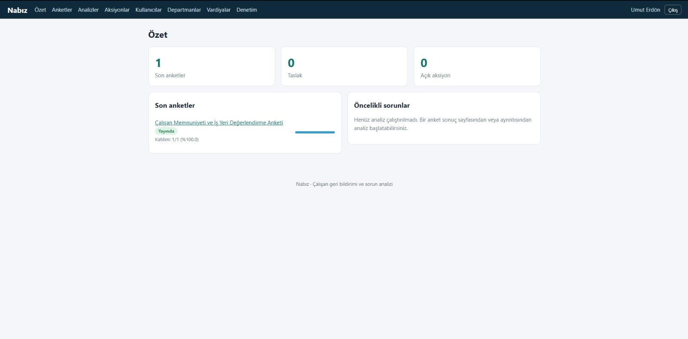

# Nabız

Anonim çalışan geri bildirimi toplayan, sonuçları gizlilik eşiğiyle gösteren ve sorunları analiz eden web uygulaması.

**Teknolojiler:** Python, Flask, MySQL 8, SQLAlchemy, Flask-Migrate, Flask-Login, Flask-WTF, pytest

## Özellikler

- **Rol bazlı giriş:** sistem yöneticisi, işletme yöneticisi, çalışan
- **Anket oluşturucu:** Likert, evet/hayır, çoktan seçmeli ve açık uçlu sorular
- **Anonim yanıt:** yanıtlar kullanıcı hesabına bağlanmaz
- **Gizlilik eşiği:** `MIN_GROUP_SIZE` (varsayılan 5) altındaki gruplarda sonuç gösterilmez
- **Sorun analizi:** yaygınlık, trend ve öncelik skoru hesaplanır; hesaplama ekranda açıklanır
- **İsteğe bağlı yapay zekâ özeti** (şu an yalnızca Anthropic API'si desteklenir; yoksa kural tabanlı analiz çalışır)
- **Aksiyon takibi:** tespit edilen sorundan iyileştirme planına
- **Güvenlik:** CSRF koruması, giriş denemesi sınırı, işletme bazlı veri izolasyonu, denetim kaydı

## Ekran görüntüleri




## Roller

- **system_admin:** işletme ve ilk yönetici hesabını oluşturur; yanıt verilerini göremez.
- **org_manager:** kendi işletmesinde departman, vardiya, kullanıcı, anket, sonuç, analiz ve aksiyonları yönetir.
- **employee:** kendisine atanan anketleri anonim yanıtlar.

## Kurulum

```bash
python -m venv .venv
.venv\Scripts\activate          # Windows (macOS/Linux: source .venv/bin/activate)
pip install -r requirements.txt
copy .env.example .env          # sonra değerleri düzenleyin
```

### MySQL veritabanları

```sql
CREATE DATABASE nabiz_dev  CHARACTER SET utf8mb4 COLLATE utf8mb4_0900_ai_ci;
CREATE DATABASE nabiz_test CHARACTER SET utf8mb4 COLLATE utf8mb4_0900_ai_ci;
CREATE USER 'nabiz_user'@'localhost' IDENTIFIED BY 'GucluBirParola';
GRANT ALL PRIVILEGES ON nabiz_dev.*  TO 'nabiz_user'@'localhost';
GRANT ALL PRIVILEGES ON nabiz_test.* TO 'nabiz_user'@'localhost';
FLUSH PRIVILEGES;
```

`.env` içindeki `DB_USER` ve `DB_PASSWORD` değerlerini buna göre yazın.

### Tabloları oluşturma

```bash
set FLASK_APP=run.py            # Windows (macOS/Linux: export FLASK_APP=run.py)
flask db upgrade
flask seed-categories
flask create-sysadmin
```

### Çalıştırma ve test

```bash
python run.py                   # http://127.0.0.1:5000
pytest -v
```

## İlk kullanım

`flask create-sysadmin` ile oluşturduğunuz hesapla giriş yapın. *İşletmeler* sayfasından işletme ve yönetici oluşturun. Yönetici departman, vardiya ve çalışan ekler (tek tek veya CSV ile), sonra anket oluşturup yayınlar.

Geliştirmede örnek veri için: `flask create-demo-data` (yalnızca `FLASK_ENV=development`).

Saklama süresi dolan yanıtları silmek için `flask purge-expired` komutunu günlük çalıştırın (cron / Görev Zamanlayıcı).

## Yapay zekâ (isteğe bağlı)

`.env` içinde `AI_PROVIDER=anthropic`, `AI_API_KEY` ve `AI_MODEL` doldurulursa analiz sayfasında yapay zekâ özeti görünür. Varsayılan olarak sağlayıcıya yalnızca toplulaştırılmış metrikler gönderilir; serbest metinler gönderilmez.

## Gizlilik notları

- Yanıt kayıtları kullanıcıya bağlı değildir; katılım kaydı ayrı tabloda, yalnızca gün olarak tutulur.
- Küçük gruplar için eşik uygulanır; bu, mutlak anonimlik garantisi değildir.
- KVKK yükümlülükleri (aydınlatma metni, saklama süresi, veri işleyen sözleşmeleri, yurt dışına aktarım) ayrıca hukuki değerlendirme gerektirir.

## Bilinen sınırlamalar

- Giriş denemesi sınırı süreç içi tutulur; çok işlemli kurulumda Redis gibi ortak depo gerekir.
- Geçici parola ilk girişte zorunlu değiştirilmez.
- E-postayla parola sıfırlama yoktur.
- Üretimde HTTPS, `FLASK_ENV=production` ve güçlü bir `SECRET_KEY` gerekir.